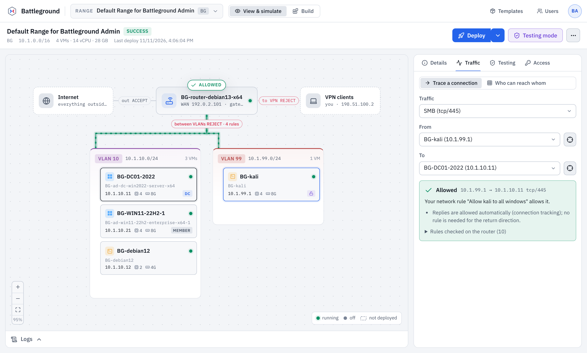
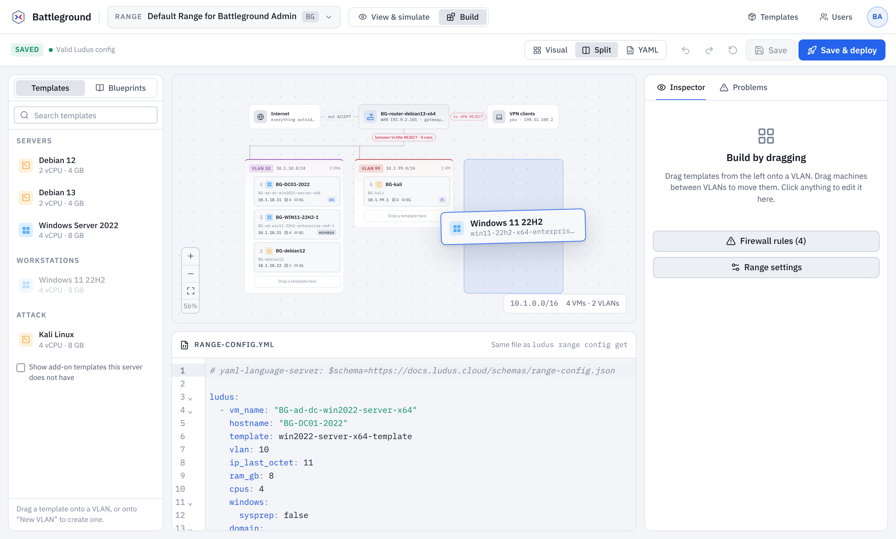

# Battleground

A portable cyber range you run anywhere Node.js or Docker runs. It works like
[Ludus](https://docs.ludus.cloud): the same range-config YAML, the same REST API (so the real
`ludus` command-line client works against it), the same validation messages, and the same
deployment log. The difference is that nothing is provisioned. Battleground simulates the
Proxmox host, the router and the machines, so you can design, deploy and test ranges on a laptop.

It has a web UI with two tabs:

- **View & simulate** shows the live range: deploy it and watch the Ansible log stream, power
  machines on and off, take and revert snapshots, turn on testing mode, download the access
  files, and trace any connection through the router's firewall.
- **Build** is a drag-and-drop range designer. Drag templates onto VLANs, drag machines between
  VLANs, edit details in the inspector, or edit the YAML directly. The map and the YAML stay in
  sync, and every change is checked the way a Ludus server checks it.





## Quick start

These steps follow the Ludus quick start (install the server, then deploy a range).

### 1. Install and start the server

With Docker:

```sh
git clone https://github.com/kaligraeme/battleground.git
cd battleground
docker compose up -d
docker compose logs battleground   # shows the admin password and API key
```

Or with Node.js 20.19 or later:

```sh
git clone https://github.com/kaligraeme/battleground.git
cd battleground
npm ci
npm run build
npm start                          # same as: node dist/battleground.mjs
```

`npm run build` produces a single file, `dist/battleground.mjs`, plus the web UI in
`dist/public`. Copy the `dist` folder to any machine with Node.js and run it there. No other
installation is needed.

On first start Battleground creates an admin account and prints its credentials once:

```
  Web UI:   http://127.0.0.1:8080/ui/
  API:      http://127.0.0.1:8080/api/v2  (Ludus compatible)

  First run: an admin account was created. Save these now; they are not shown again.
    Sign in:   admin@battleground.local (or BG)
    Password:  …
    API key:   BG.…
```

Set `BATTLEGROUND_ADMIN_PASSWORD` before the first start to choose the password yourself. If you
lose it, `battleground reset-admin` (or `node dist/battleground.mjs reset-admin`) prints new
credentials.

By default the server listens on `127.0.0.1` only. Use `--host 0.0.0.0` to reach it from other
machines. The Docker image already does this.

### 2. Deploy a range

**In the browser:** open the web UI and sign in. Your default range already holds the Ludus
example config: a domain controller, a domain-joined Windows 11 workstation and a Kali box.
Click **Deploy** and open **Logs** to follow it. Then switch to **Build** to change the range,
and use **Save & deploy** to apply the change.

**With the Ludus CLI:** point the regular `ludus` client at Battleground:

```sh
export LUDUS_URL=http://127.0.0.1:8080
export LUDUS_API_KEY='BG.…'

ludus range config get > config.yml   # edit it, then:
ludus range config set -f config.yml
ludus range deploy
ludus range logs -f
ludus range status
```

All range, user, template, testing, snapshot, Ansible, group and blueprint commands are
answered.

## The web UI

### View & simulate

- **Range map.** The internet, the router, the VPN clients, and one lane per VLAN, with each
  machine's address, size and power state. Machines that are configured but not deployed are
  drawn dashed. During a deployment each machine shows the task it is on.
- **Deploy.** Deploy everything, apply only network changes (`--tags network`), or choose tags
  and machines. The log is the output a Ludus deployment prints, played back at the simulation
  speed, with PLAY RECAP and failures included. You can abort a deployment.
- **Traffic.** Pick a source and a destination (a machine, an internet host, your VPN client or
  the router) and a service. The simulator walks the router's iptables chains and tells you
  whether the connection is accepted, rejected or dropped, and which rule decided it. **Who can
  reach whom** shows the same decision for every pair at once. It can use the rules the router
  was last deployed with, or the saved config.
- **Testing.** Testing mode snapshots the machines and cuts the range off from the internet,
  except machines set to `testing.block_internet: false`. Allow and deny domains or IPs.
  Stopping testing mode reverts the snapshots.
- **Details.** Machine details, login and services, power, and snapshots (take, revert,
  delete).
- **Access.** Download the hosts file, the RDP profiles (zip) and the Ansible inventory. See
  the machine credentials.

### Build

- **Palette.** Templates grouped as servers, workstations, attack and analysis. Drag one onto a
  VLAN, or onto **New VLAN** to start one. Double-click a template, or press Enter, to add it to
  the selected VLAN. **Blueprints** offers ready-made ranges (basic AD lab, segmented corporate
  network, pivot lab, detection lab, isolated detonation lab, empty) and your saved blueprints.
- **Map.** Drag machines between VLANs. A machine whose address is taken on the new VLAN gets
  the next free one.
- **Inspector.** Edit a machine (hostname, template, address, size, Windows/Linux options,
  domain role, testing behaviour, Ansible roles), a VLAN (renumbering it also updates the rules
  that mention it), the router, the firewall (defaults and an ordered rule list), and range-wide
  settings.
- **YAML.** A CodeMirror editor showing the same file as `ludus range config get`. Edits in the
  map keep your comments and layout. Problems are underlined where they are, and are listed
  under **Problems**. Problems that a Ludus server would reject are kept apart from advice.
- Undo and redo (Ctrl+Z, Ctrl+Shift+Z), Ctrl+S to save, and a Visual / Split / YAML layout.

## Configuration

| Flag | Environment variable | Default | |
| --- | --- | --- | --- |
| `--host` | `BATTLEGROUND_HOST` | `127.0.0.1` | Address to listen on |
| `--port` | `BATTLEGROUND_PORT` | `8080` | Port for the API and web UI |
| `--data` | `BATTLEGROUND_DATA_DIR` | `./data` | Where state and logs are kept |
| `--speed` | `BATTLEGROUND_SPEED` | `60` | Simulated seconds per real second; `0` finishes every step at once |
| `--unbuilt-templates` | `BATTLEGROUND_TEMPLATES=unbuilt` | | Start with no templates built |
| `--tls-cert`, `--tls-key` | `BATTLEGROUND_TLS_CERT`, `BATTLEGROUND_TLS_KEY` | | Serve HTTPS |

The first-run admin account can be set with `BATTLEGROUND_ADMIN_NAME`, `BATTLEGROUND_ADMIN_USERID`,
`BATTLEGROUND_ADMIN_EMAIL` and `BATTLEGROUND_ADMIN_PASSWORD`. Admins can also change the
simulation speed in the UI (**Settings**).

All state lives in the data directory, so back it up or mount it as a volume (the Docker image
uses `/data`).

## How it compares to Ludus

Battleground reproduces what a Ludus user sees:

- **Range config.** The same YAML (read with YAML 1.1 rules, so `yes` and `no` are booleans), the same schema, and
  the same checks in the same order, with the same error text. That includes duplicate names and
  addresses, 15-character Windows hostnames, unbuilt templates, and Ansible role dependencies.
- **Addressing.** Range *N* is `10.N.0.0/16`, each VLAN is `10.N.V.0/24`, the router is `.254`
  on every VLAN with WAN address `192.0.2.(100+N)`, and VPN clients are `198.51.100.<user number>`.
- **Router firewall.** Default policies, user rules (later rules take precedence, as on a Ludus
  router), `always_blocked_networks`, VPN access for users the range is shared with, and the
  testing-mode chain.
- **Deployments.** The plays and tasks of the Ludus deployment playbook, only the steps the
  config and tags call for, `--limit`, failures (for example an unbuilt template), redeploys, and
  aborts. Each run is kept in the log history.
- **The API.** Users and API keys, impersonation (`?userID=`), range selection (`?rangeID=`),
  shared and group access, ranges, templates (build, add, delete, logs), testing,
  snapshots, power, Ansible roles and collections, groups, blueprints, and the downloads.

What is different:

- **No virtual machines.** Machines, snapshots and power states are records. Nothing runs, so
  you cannot log in to a machine, and the VPN profile is generated for reference only.
- **Ansible roles** you install are recorded, so configs that use them validate and their plays
  appear in the deployment log. They are not executed.
- **Template builds** are simulated with a Packer-style log. Uploading a template directory
  (`ludus templates add -d`) registers the template.
- **Enterprise plugin endpoints** (quotas, KMS, anti-sandbox, auto-shutdown, machine credentials
  export) answer like a Ludus server without the plugin. Remote sources and the migration
  commands return `501 Not supported by Battleground`.
- **Allowing a domain in testing mode** resolves it with this machine's DNS, as a Ludus server
  would. Without network access the domain cannot be allowed, but IP addresses still can.

## Development

```sh
npm ci
npm run dev         # API server on :8080 and the Vite UI on :5173, both reloading on change
npm test            # unit and API tests (Vitest)
npm run typecheck
npm run e2e         # builds, then runs the browser tests (Playwright)
```

The browser tests need Playwright's Chromium (`npx playwright install chromium`).

The code is split into three packages:

- `packages/core` holds the range-config model, YAML handling, Ludus-identical validation,
  addressing, and the firewall simulator. The server and the UI both use it.
- `packages/server` holds the Ludus-compatible API (Hono), the deployment and template-build
  simulators, and the JSON state store.
- `packages/web` holds the React UI: the range map, the Build tab and the View tab.

## Relationship to Ludus

Battleground is an independent project. It is not affiliated with or endorsed by Bad Sector
Labs, the makers of Ludus. It was built by studying Ludus's open-source code and documentation.
The example range config, the validation messages and the Ansible play and task names are taken
from Ludus, which is licensed under the GNU AGPL v3.0.

This repository does not have a license yet. Because it reuses that material, AGPL-3.0 is the
natural choice when you add one.
