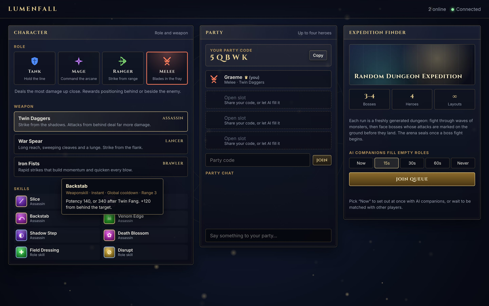
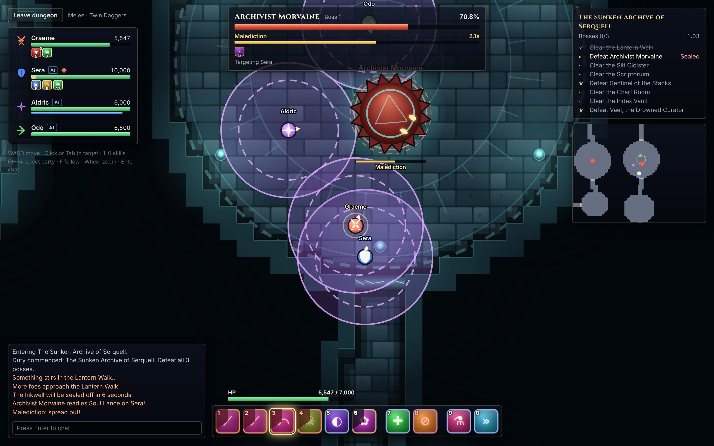
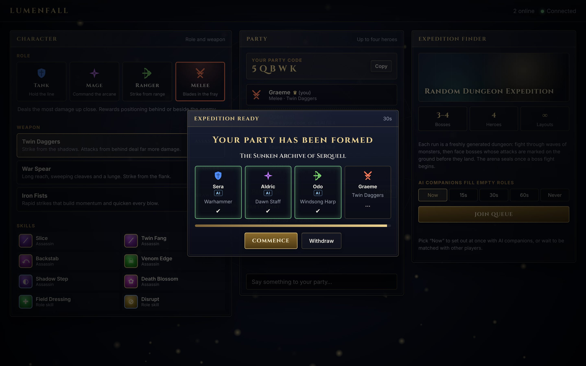

# Lumenfall

A four-player co-op dungeon RPG that runs in the browser. Form a party of four (Tank, Mage,
Ranger and Melee) and fight through a dungeon that is generated fresh for every run: waves of
monsters, then 3 or 4 bosses whose attacks are marked on the ground before they land. Players
queue together or alone, and AI companions fill any role nobody is playing.

The look and feel takes its cues from big fantasy MMO dungeons: a finder queue with a ready
check, a global cooldown with combos and off-cooldown abilities, enmity and taunts, sealed boss
arenas, and orange telegraphs you step out of. All names, art, skills and bosses are original.





## Quick start

You need Node.js 20.19 or later.

```sh
cd dungeon
npm ci
npm run build
npm start            # http://127.0.0.1:8787
```

Open the address, pick a name, choose a role and weapon, set **AI companions fill empty roles**
to **Now** and press **Join Queue**. Accept the ready check with **Commence**.

To play with friends on your network, start the server with `npm start -- --host 0.0.0.0` and
have them open `http://<your-ip>:8787`. One player shares their **party code**; the others
type it into **Party code** and press **Join**. The party leader then joins the queue.

Server options:

| Option | Effect |
| --- | --- |
| `--port 8787` | Port for the web page and the game socket. |
| `--host 127.0.0.1` | Interface to listen on. Use `0.0.0.0` for LAN play. |
| `--quick` | Monsters have a quarter of their health. Good for trying things out. |
| `--countdown 5` | Seconds before the entrance barrier drops. |

For development, `npm run dev` runs the server with reload on port 8787 and the Vite client on
http://localhost:5173 (it forwards the game socket to the server).

## How a run works

1. **Lobby.** Choose one of four roles and one of its three weapons. Each weapon has six unique
   skills; each role adds two role skills, and everyone has Elixir and Sprint.
2. **Party.** Everyone starts in their own party with a 5-letter code. Up to four players can
   join one party. Each member needs a different role to queue.
3. **Queue.** The leader picks when AI companions should fill empty roles (now, after 15, 30 or
   60 seconds, or never) and joins the queue. The matchmaker merges parties whose roles do not
   overlap, oldest first. A full party of four starts at once.
4. **Ready check.** Everyone in the group gets an *Expedition Ready* window and has 30 seconds to
   press **Commence**. If someone withdraws, the others go back to the queue at their original
   place.

   

5. **The dungeon.** A chain of rooms joined by corridors. In front of each boss are one or two
   rooms you clear in 2 or 3 waves; barrier gates open as you clear them. Each boss arena seals
   six seconds after the fight starts. The last boss is always the dungeon's sovereign, with
   three phases.
6. **Wipes.** If the whole party falls, everyone returns to the last checkpoint and the
   encounter resets. Each wipe adds a stack of *Lumen's Echo* (up to 3): 10% more damage dealt
   and 10% less damage taken per stack.
7. **Results.** When the final boss falls you get the clear time and each hero's damage,
   healing and knockouts.

Each dungeon draws on one of four themes (the Sunken Archive, the Ember Foundry, the Frostbound
Ossuary and the Verdant Hollow), which set the palette, monster names and boss names.

## Controls

| Key | Action |
| --- | --- |
| W A S D or arrows | Move |
| Click, Tab / Shift+Tab | Select a target; cycle through nearby enemies |
| 1 – 9, 0 | Use the skill in that hotbar slot (pressing just before the cooldown ends queues it) |
| F1 – F4 | Select a party member |
| F | Follow your selected party member, or the tank. Moving cancels it. |
| Esc | Clear your target |
| Enter | Chat |
| Mouse wheel | Zoom |

Enemy skills need an enemy selected; if none is, the nearest enemy in range is picked for you.
Healing skills land on your selected ally, or on you. Spells with a cast time are cancelled if
you move before the last moment of the cast.

## Roles and weapons

| Role | Weapon | Style | What it does |
| --- | --- | --- | --- |
| Tank | Sword & Shield | Guardian | Three-hit combo that heals, a stunning shield bash, Bulwark (40% mitigation) |
| Tank | Greataxe | Berserker | Hardest-hitting tank; Bloodthirst turns damage into healing |
| Tank | Warhammer | Juggernaut | Stone barriers, a slowing slam and a long stun |
| Mage | Dawn Staff | Restorer | The healer: single, over-time and area heals, wards, and Resurrection |
| Mage | Ember Tome | Pyromancer | Long casts, burning damage over time, procs that make Inferno Lance instant |
| Mage | Storm Scepter | Stormcaller | Instant lightning you can cast while moving, chain hits, party haste |
| Ranger | Longbow | Marksman | Precise shots; Hawkeye procs unlock True Shot |
| Ranger | Repeater Crossbow | Skirmisher | Fast combo, caltrops that slow, a knockback bolt that interrupts |
| Ranger | Windsong Harp | Bard | Party damage and healing songs, a chord that silences casters |
| Melee | Twin Daggers | Assassin | Bonus damage from behind the target, poison, a step behind the enemy |
| Melee | War Spear | Lancer | Bonus damage from the flank, a wide cleave, a lunge |
| Melee | Iron Fists | Brawler | A combo that speeds up every action, a big single hit |

Tanks generate four times the enmity of other roles and have **Taunt** to pull an enemy off an
ally. Several weapons and role skills can **interrupt** casts that pulse on the cast bar
(healers and bolt-casters in the trash packs).

There is no dedicated healer role, so the Dawn Staff is optional. AI companions filling the Mage
slot always bring it. A party without a Dawn Staff gets *Lumen Ward*: 15% less damage taken and a
slow heal in combat.

## Reading boss mechanics

| Marker | Meaning |
| --- | --- |
| Orange area filling up | Damage lands when it fills. Get out. Cones, circles, rings (stand inside the safe middle), lines and crosses. |
| Gold circle with arrows pointing in | **Stack**: the damage is shared by everyone inside. Stand together. |
| Purple circle on each player | **Spread**: each circle also hits anyone else inside it. Spread out. |
| Red circle and diamond over a head | **Tank buster**: a heavy hit on the target. Tanks: use a defensive skill. Others: stay clear. |
| Blue arrows around the boss | **Knockback**: everyone is thrown away from the boss. |
| Red screen edges | **Raid-wide** damage is about to hit everyone. |

Getting hit by an avoidable attack adds *Vulnerability Up* (25% more damage taken per stack for
10 seconds). Bosses change phase as their health drops, adding new attack combinations and
summoning adds.

## How it is built

```
dungeon/
  src/shared/      Game rules both sides use: constants, geometry, tile map with collision,
                   line of sight and A* pathfinding, the network protocol, and the content
                   (roles, weapons, skills, statuses, monsters, bosses, themes).
  src/server/      Node.js server.
    dungeonGen.ts  Seeded dungeon generator.
    sim/           The dungeon simulation: instance (rooms, waves, gates, wipes), combat
                   (skills, damage, healing, statuses), mechanics (telegraphs and bosses),
                   monster AI.
    ai/botAI.ts    AI companions: targeting, role positioning, dodging, stack and spread,
                   healing, raising, taunting, interrupting, leading the party.
    matchmaker.ts  Role-unique queue with AI fill.
    lobby.ts       Players, parties, queue, ready checks, instances, reconnects.
    main.ts        HTTP server for the client and the WebSocket at /ws.
  src/client/      Browser client (TypeScript and canvas, no framework).
    ui/            Title screen and lobby.
    game/          World state, renderer, HUD, effects, input and prediction.
  test/            Unit tests and full dungeon runs.
  e2e/             Browser test with two players.
```

- **Server-authoritative.** The server simulates every dungeon at 20 ticks per second and sends
  each player a snapshot 10 times a second. It decides every hit, heal, cooldown and AI action.
- **Smooth movement.** Your own character moves immediately on your screen using the same
  collision code as the server. The server checks each move against your speed and the walls. When
  it moves you itself (dashes, knockbacks, wipes), it bumps a counter so stale positions are
  ignored. Everyone else is drawn slightly in the past and interpolated between snapshots.
- **Deterministic content.** A dungeon is generated from a seed, so the same seed gives the same
  layout, rooms, waves and bosses.
- **Reconnects.** The browser keeps a token. If you drop out of a dungeon, an AI companion plays
  your character until you reconnect, then hands it back.

## Tests

```sh
npm test            # unit tests, plus complete dungeon runs by AI-only parties
npm run typecheck
npm run e2e         # builds, then drives two browsers through a party, queue and first room
npm run simulate -- 42 5   # play 5 dungeons (seeds 42-46) with AI parties and print results
```

The simulation tests make four AI parties with different weapons clear entire dungeons. That
checks the generator, the combat rules, every boss and the AI together, and keeps the balance
honest. With a healer, AI parties clear a dungeon in about 8 to 12 minutes, usually with no
wipes.

## Ideas for what is next

- Gear and rewards from bosses, and character progression between runs.
- Accounts and saved characters (players are currently kept in memory by the server).
- Sound and music, and hand-drawn art in place of the vector shapes.
- More themes, bosses and mechanics (towers to soak, tethers, line stacks, gaze attacks).
- A harder difficulty and a timed leaderboard.
- Rate limiting and stricter validation before running a public server.
